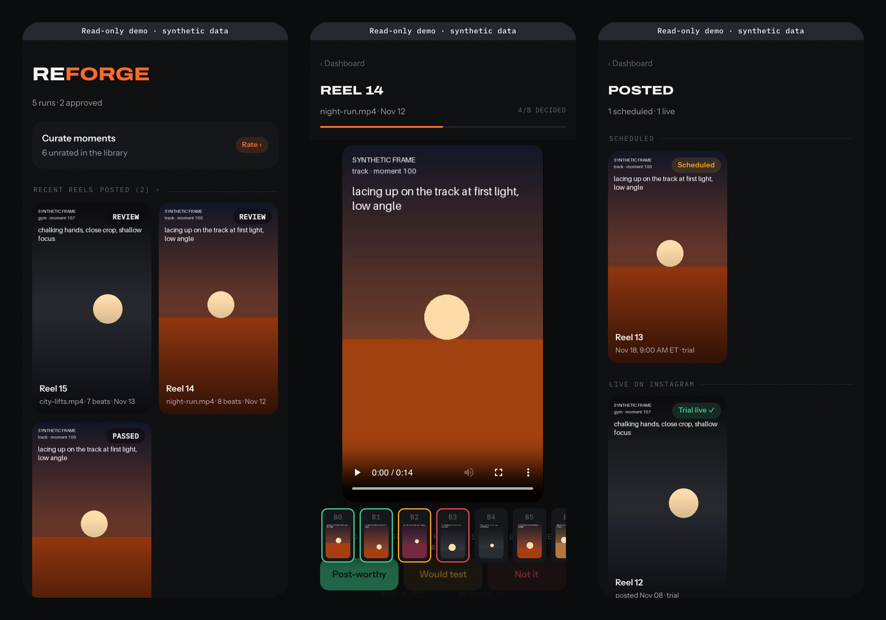
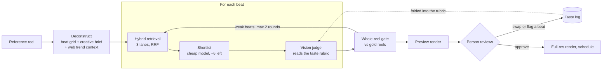

# Reforge

**Agentic video RAG: give it a reference reel, and it rebuilds the cut beat by beat from your own footage. A person approves every reel before it posts.**

[](https://github.com/Logan-Cope/reforge/actions/workflows/ci.yml)




**[Live demo](https://reforge-demo-ashen.vercel.app)** (read-only, synthetic data: browse every screen, nothing can be graded, scheduled or posted)

## Results

The hard part is retrieval. A footage library is thousands of near-identical gym and street shots, single-frame CLIP can't see verbs or energy, and only about six candidates per beat ever reach the judge, so early precision decides the reel. The hybrid retriever was measured against the CLIP-only baseline on a 33-beat labeled set built from three reference reels (1,459 pooled candidates, 893 labeled relevant):

| Metric | CLIP only | Hybrid (CLIP + captions/HyDE + BM25, RRF) | Change |
| --- | --- | --- | --- |
| precision@5 | 0.497 | **0.776** | +56% |
| precision@10 | 0.491 | **0.742** | +51% |
| recall@20 | 0.342 | **0.542** | +58% |
| hit@5 | 0.848 | **0.970** | +14% |
| MRR | 0.647 | **0.876** | +35% |

An independent LLM judge then scores each finished reel 0 to 100 against gold reference reels (past reels the creator approved, which set the bar). On a batch of 15 fully automated reels from new references, scores ranged 48 to 88 (median 61); the judge cleared one to post as-is and named the exact weak beats on the other 14.

Every number above is recomputed from the files in [`eval_results/`](eval_results/) by `python scripts/summarize_evals.py`, and a test pins them. Method, caveats and per-beat tables: [docs/EVALS.md](docs/EVALS.md).

## How it works



1. **Deconstruct.** A vision model turns the reference into a beat grid and a creative brief (vibe, energy arc, the role and intended feeling of every beat). A web search adds context on why the format is trending.
2. **Retrieve.** Each beat queries the footage index through three lanes and fuses them (below).
3. **Shortlist, then judge.** A cheap model trims the pool to about six finalists. A strong vision model looks at five frames per finalist, reads the written taste rubric, and picks one with a one-line reason.
4. **Gate.** A second pass judges the assembled reel as a whole against gold reference reels and re-picks weak beats with its critique attached, for at most two rounds.
5. **Review.** The preview goes to a phone-first app. The reviewer keeps, swaps to a runner-up, or flags each beat, then grades the reel. Every decision is written to an append-only taste log; recurring corrections are folded into the rubric the judge reads on the next run (by hand today).

## The retrieval design

- **Retrieval unit = edit unit.** Every clip is cut into motion-aware windows of about 1.75 seconds, the length one cut holds in a fast reel. Quality-aware segmentation drops the camera-handling head and tail of each take, so "picking up the phone" never becomes a retrievable moment.
- **Lane 1, CLIP image kNN.** open-clip `ViT-L-14` over each window's frame, matched against the reference frame, in Postgres with pgvector.
- **Lane 2, caption text with HyDE.** Every window carries an action-focused caption. Each beat is turned into a hypothetical ideal caption ("explosive push-up at the bottom of the rep, high effort, at night") and embedded with `text-embedding-3-small`, so the query asks for what the beat needs instead of what the reference frame happens to look like.
- **Lane 3, BM25** over the same captions with Postgres full-text search. No new infrastructure.
- **Reciprocal Rank Fusion** (k = 60) merges the lanes without score normalization, so agreement across lanes beats one lane's outlier.
- **Down-weight, never drop.** A quality score (exposure, sharpness, stability, subject present) inflates a weak window's distance instead of deleting it; automated scorers over-flag intentionally dark footage, so removal stays a human call. Freshness and a per-location cap keep the same clip from repeating across reels.
- **A tiered ingest cache** content-addresses the expensive artifacts (frames, embeddings, captions) per clip, so re-scoring the whole library takes seconds instead of a multi-hour re-ingest.

Diagrams of the data model, the cloud/local split and the run queue are in [docs/ARCHITECTURE.md](docs/ARCHITECTURE.md).

## Try it

The read-only demo runs on bundled synthetic data with no database and no API keys:

```bash
git clone https://github.com/Logan-Cope/reforge && cd reforge
python3.12 -m venv .venv && source .venv/bin/activate
pip install -r requirements-dev.txt         # light deps: enough for the tests and the demo

pytest -q                                   # 460+ tests, no keys, no database
DEMO_FIXTURES=1 DEMO_READ_ONLY=1 PYTHONPATH=src uvicorn reforge.app.main:app
# open http://127.0.0.1:8000
```

`DEMO_READ_ONLY=1` refuses every non-GET request with a 403 before any route runs; `tests/test_demo_read_only.py` discovers every write route from the app and proves each one is refused. `DEMO_FIXTURES=1` serves the synthetic reels in `src/reforge/demo/` (regenerate them with `scripts/make_demo_data.py`).

The full pipeline needs Postgres with pgvector, ffmpeg, the heavy ML dependencies and model keys: `pip install -e ".[dev]"`, copy `.env.example` to `.env`, apply `db/schema.sql`, then `scripts/ingest_library.py`, `scripts/run_graph.py` and `scripts/run_eval.py`. Publishing is dry-run unless both a provider and an explicit live latch are set.

## Repo layout

```
src/reforge/
  ingest/       footage -> motion-aware windows -> captions, quality, embeddings (tiered cache)
  deconstruct/  reference reel -> beat grid + creative brief
  match/        hybrid retrieval, shortlist, vision judge, whole-reel gate
  eval/         retrieval metrics, pooled labeling, would_post judge
  graph.py      LangGraph run with a human-review interrupt
  render/       edit decision list -> ffmpeg render
  app/          FastAPI + HTMX review app (and the read-only demo seam)
  publish/      scheduling and dry-run-by-default publishing
db/             schema + migrations (pgvector, run queue, taste events)
taste/          the rubric the judge reads on every run
eval_results/   raw eval outputs behind every number above
tests/          pytest, no network
```

## Stack

Python 3.12 · FastAPI, HTMX, Jinja · Postgres + pgvector · open-clip ViT-L-14 · OpenAI text embeddings · Claude (Haiku for captions and the shortlist, Opus for the judge and gate) · LangGraph · LangSmith tracing · ffmpeg · pytest

## License

MIT
