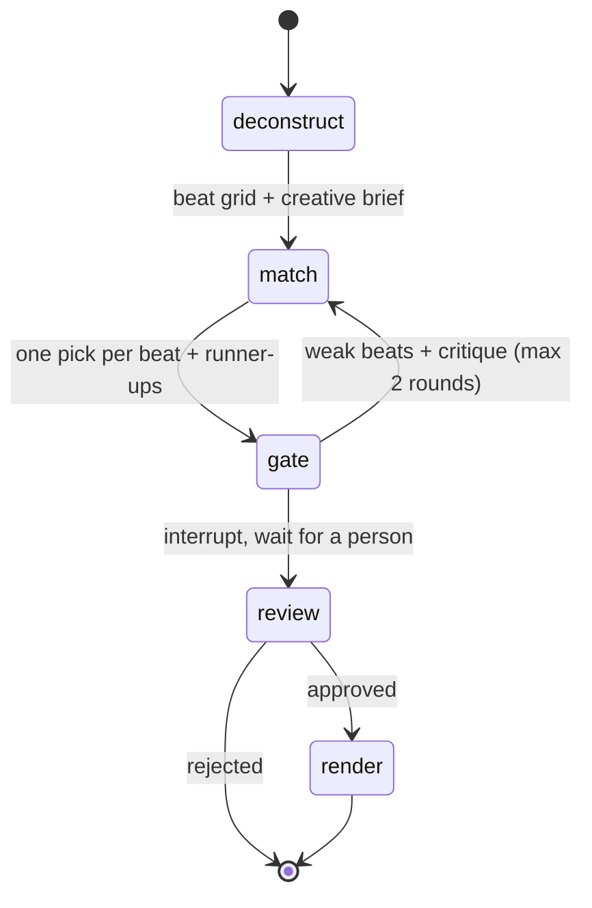
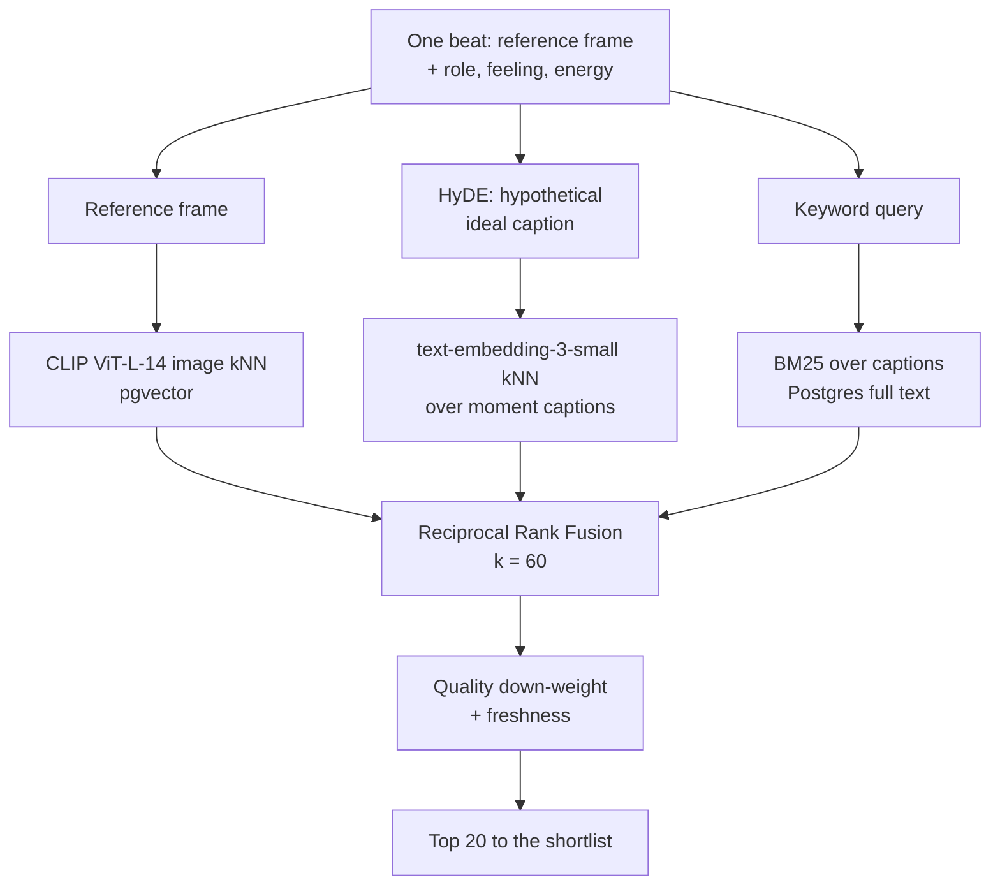
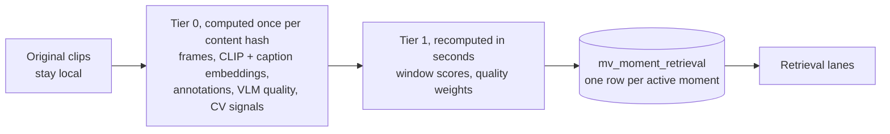
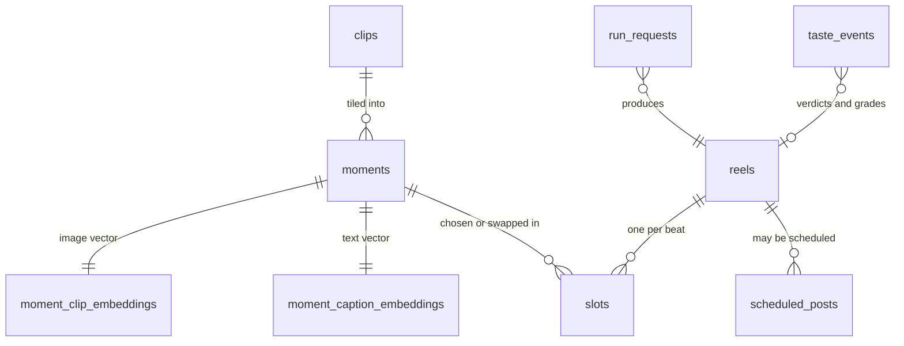
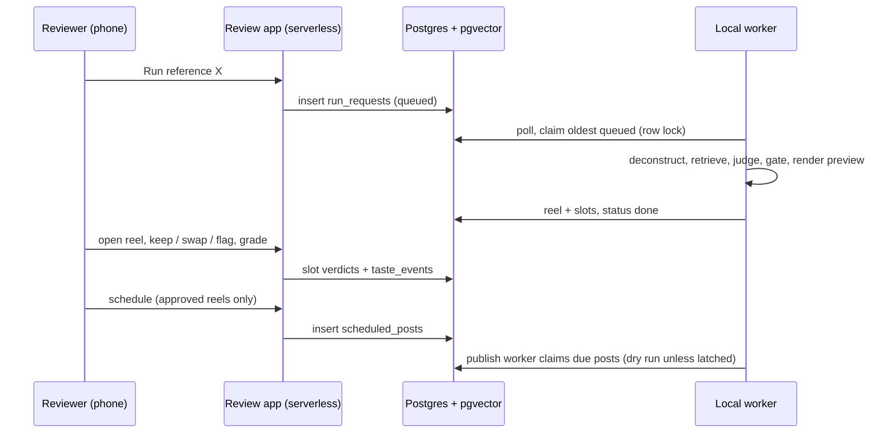
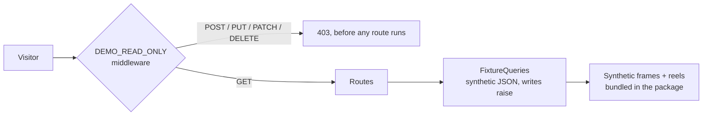

# Architecture

Reforge is a retrieve-then-rerank system over video. Recall comes from cheap vector and text search over short windows of footage; quality comes from a strong vision judge over a handful of finalists; trust comes from a person approving every reel. This page covers the shape of the system. The retrieval results and how they were measured are in [EVALS.md](EVALS.md).

## 1. The agent run

The pipeline is a LangGraph state machine (`src/reforge/graph.py`) with a checkpointed interrupt at human review, so a run can pause for hours on a phone and resume where it stopped.

| Stage | Code | What it does |
| --- | --- | --- |
| deconstruct | `deconstruct/reference.py`, `acquire/trends.py` | Cut detection on the reference, then a vision model writes the brief: vibe, energy arc, and per beat a role, intended feeling and intended energy. A web search adds trend context. |
| match | `match/retrieve.py`, `match/matcher.py` | Per beat: hybrid retrieval (top 20), a cheap shortlist to about 6, then the vision judge sees 5 frames per finalist plus the taste rubric and picks one with a reason. Diversity rules stop clip reuse and cap clips per location. |
| gate | `match/gate.py` | Judges the assembled reel against gold reference reels and the rubric. Weak beats are re-matched with the critique appended, excluding moments already rejected. |
| review | `app/` | The phone-first review app (below). Every verdict becomes a taste event. |
| render | `render/engine.py`, `render/recipe.py` | An edit decision list rendered by ffmpeg: 480p preview from proxies, full resolution from the originals. |

## 2. Retrieval in detail

- **Windows, not clips.** `ingest/segment.py` finds motion-stable spans in each take and tiles them into windows of about 1.75 seconds, the length of one cut. High-motion heads and tails (setting the camera down, walking into frame) fall outside the stable spans and never become moments.
- **One annotation per clip, one embedding per window.** A vision model annotates each clip once (who is in it, location, energy, an action-focused caption); every window inherits it and gets its own CLIP frame embedding and caption embedding.
- **Fusion without normalization.** Each lane returns a ranked list; RRF scores a moment by `sum(1 / (60 + rank))` across lanes, so consensus beats a single lane's outlier and the lanes' incompatible distance scales never meet.
- **Down-weight, never drop.** `quality_adjusted_distance` adds `weight * (1 - quality)` to a moment's distance. Quality combines exposure, sharpness, stability and whether a person is detected. Nothing is deleted automatically.
- **The CLIP-only path stays in the code** (`RETRIEVER=clip`) as the regression baseline the eval compares against.

## 3. Ingest and the tiered cache

Expensive artifacts live in `cache_*` tables keyed by content hash and a version string per producer (`ingest/cache.py`), so changing a scoring formula re-runs Tier 1 over the whole library in seconds instead of re-ingesting everything. A materialized view joins the active moments, their embeddings and their scores into the single table the retrieval lanes read.

## 4. Data model (core tables)

`slots.candidates` keeps the runner-ups (with their scores, reasons and in-points) so a swap in the app never needs another retrieval. `taste_events` is the durable copy of every human decision; the local worker syncs it into `taste/taste-log.jsonl`.

## 5. Cloud app, local worker

The web app is FastAPI with server-rendered Jinja and HTMX, deployed as one serverless function. It can't run ffmpeg or CLIP, and the original footage shouldn't leave the machine it was shot on, so it only reads and writes rows and queues work. The worker (`scripts/worker.py`) does the heavy compute and pushes previews to object storage. Every tap in the app is one database round trip: verdict writes return the refreshed row in a single CTE, and taste events are written after the response is sent.

Publishing is guarded twice: `publish/providers.py` sends nothing real unless a provider is configured **and** a separate live latch is set; anything else is a dry run.

## 6. The public demo

Two env flags turn the review app into a safe public demo (`app/main.py`):

- `DEMO_FIXTURES=1` swaps the database seam for `FixtureQueries`, which serves `src/reforge/demo/fixtures.json` and bundled media. Everything in it is generated by `scripts/make_demo_data.py`; nothing comes from a real library. Its write methods raise `PermissionError`, a second wall behind the middleware.
- `DEMO_READ_ONLY=1` returns 403 for every method other than GET, HEAD and OPTIONS. In the browser a small script disables every write control and cancels any non-GET htmx request, so the UI matches what the server allows.

`tests/test_demo_read_only.py` walks the app's routes, finds every write route (12 today, pinned so the test can't pass empty), and asserts each returns 403 without reaching the data layer. Disabling the middleware makes 5 of its tests fail, which is how the test was checked.

The demo deploy has no database URL, no model keys and no publish provider configured.
