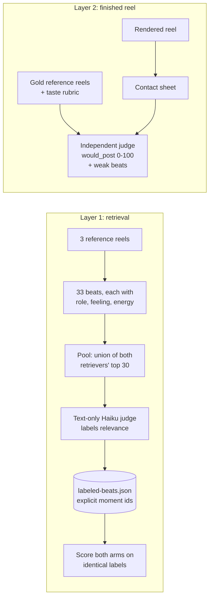

# Evals

Two things can each ruin a reel on their own: the retriever never surfaces the right moment, or the judge picks the wrong one from a good pool. So the harness in `src/reforge/eval/` measures them separately: retrieval metrics on labeled beats, and an independent LLM judge on finished reels.

Every headline number here is recomputed from the raw files in `eval_results/` by `python scripts/summarize_evals.py`, and `tests/test_eval_results.py` pins them.



## Layer 1: retrieval on a pooled-relevance set

**Why a synthetic set.** The first retrieval eval scored against the hand-written taste log. That log only yields two beats with resolvable clip labels, and on two beats every arm scored 0 (`eval_results/2026-07-10-retrieval-{baseline,clip,hybrid}.md`). Two beats can't separate two retrievers, so the set was grown with standard IR pooling.

**How it was built** (`scripts/build_eval_set.py`, `src/reforge/eval/synthetic.py`):

1. Each of three reference reels is deconstructed once into beats with a creative ask: role, intended feeling, intended energy, description.
2. For every beat, the candidate pool is the union of both retrievers' top 30, deduplicated by moment id, so neither arm is judged only on the other's blind spots.
3. A cheap, text-only Haiku judge labels each pooled candidate relevant or not to the beat's ask. The bar is deliberately generous ("could this clip plausibly serve this beat?"): this measures relevance, and taste is the rerank's job.
4. Labels are stored as explicit moment ids, so both arms are scored against exactly the same set. Nothing was tuned against the labels.

Result: 33 beats, 1,459 pooled candidates, 893 labeled relevant (about 27 per beat).

**Results** (`eval_results/2026-07-10-retrieval-labeled-{clip,hybrid}.json`, means over 33 beats):

| Metric | CLIP only | Hybrid | Change |
| --- | --- | --- | --- |
| hit@5 | 0.848 | 0.970 | +14% |
| hit@10 | 0.879 | 0.970 | +10% |
| hit@20 | 0.970 | 1.000 | +3% |
| precision@5 | 0.497 | 0.776 | +56% |
| precision@10 | 0.491 | 0.742 | +51% |
| precision@20 | 0.503 | 0.700 | +39% |
| recall@20 | 0.342 | 0.542 | +58% |
| MRR | 0.647 | 0.876 | +35% |

**What it says.** Recall was never the bottleneck: even CLIP alone has a relevant clip somewhere in the top 20 on 97% of beats. Early precision was. Only about six finalists reach the judge, and the hybrid retriever moves precision@5 from roughly half to roughly three quarters. The biggest single-beat gains are on beats defined by a feeling or a rhythm rather than a look: a "breather/reset" beat went from precision@5 0.0 to 1.0, and a "rhythmic sustain" jump-rope beat from 0.0 to 0.8 (`DISCIPLINE-synth` beats 4 and 12). A single frame can't tell those apart from any other shot in the same place; a caption can.

**Where it still misses.** One beat (`grace-synth` beat 1) has only 3 relevant candidates in the pool and neither arm finds one in its top 10. Thin supply on a few beat types is the remaining gap, and the judge-side numbers below point the same way.

**Caveats, stated plainly.**
- Recall is pool-relative: labels come from a pool these two retrievers built (the standard pooling limitation). The arm-versus-arm comparison is fair because both are scored on identical labels.
- Labels come from an LLM, not a person. They measure relevance to the beat's ask, not final taste.
- One library, three references. It shows the direction and size of the change on this corpus, not a general benchmark.

## Layer 2: would_post, an independent judge on the finished reel

`src/reforge/eval/would_post.py` gives a strong vision model a contact sheet of the rendered reel, the gold reference reels and the taste rubric, and asks for a 0 to 100 score, a would-post verdict and the indexes of weak beats. It is a different call from the in-pipeline judge, so the pipeline is not grading its own homework with the same prompt.

**Calibration.** Before trusting it, the judge was checked against known anchors: a human-corrected reel scored 72, and known-mediocre pipeline output scored in the 50s.

**Unseen references** (`eval_results/2026-07-16-would-post.json`): 15 reels built fully automatically from new reference reels, no human correction.

| Reels | Median | Range | Judged postable as-is | Weak beats named |
| --- | --- | --- | --- | --- |
| 15 | 61 | 48 to 88 | 1 (scored 88) | 1 to 6 on each of the other 14 |

That spread is the signal an approve-before-post workflow runs on: it separates the reel to post from the ones that need a swap, and says which beat to swap.

**Judge-seat comparison** (one reference, one run per arm, recorded during the build; only the Sonnet arm's raw output is in `eval_results/2026-07-10-would-post.json`):

| Run | Judge | Rubric + gate | would_post |
| --- | --- | --- | --- |
| Pre-improvement baseline | Opus | no | 58 |
| Rubric + gate | Opus | yes | 61 |
| Rubric + gate | Sonnet | yes | 58 |
| Human-corrected reference point | person | n/a | 72 |

Single runs, so read it as directional: the rubric plus gate lifted the automated reel, and Opus kept the judge seat over Sonnet on quality.

## Running it

```bash
python scripts/summarize_evals.py                     # offline: recompute every number above
python scripts/build_eval_set.py                      # rebuild the labeled set (DB + keys)
python scripts/run_eval.py --labels eval_results/labeled-beats.json --retriever both
python scripts/run_eval.py --would-post output/a.mp4 output/b.mp4
```

The last three need the footage index in Postgres and model keys; they write dated JSON and markdown into `eval_results/`. The judge's free-text notes and render file names were removed from the published would-post files because they describe a private footage library; scores, verdicts and weak-beat indexes are unchanged.
